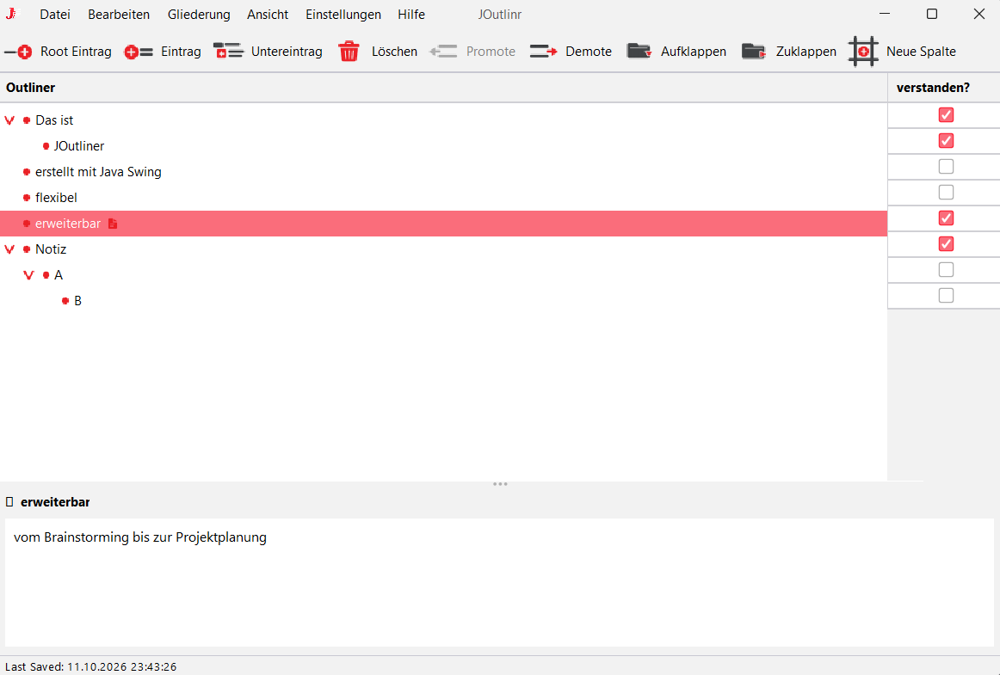

# JOutlinr


**JOutlinr** ist eine schlanke, desktopbasierte Outliner-Anwendung, mit der sich Ideen, Notizen und Gliederungen hierarchisch strukturieren lassen. Sie eignet sich besonders zur Planung und Organisation von Texten und Dokumenten, etwa für wissenschaftliche Arbeiten in LaTeX.

Das Projekt befindet sich aktuell in der **Beta-Phase** und wird aktiv weiterentwickelt.

**Repository:** [github.com/nille10/JOutlinr](https://github.com/nille10/JOutlinr)



## Funktionen

- **Hierarchische Gliederungen** in einer Baumstruktur mit bis zu drei Ebenen.
- **Flexible Bearbeitung:** Einträge erstellen, umbenennen, löschen und innerhalb der Gliederung verschieben.
- **Drag-and-drop:** Einträge und ganze Teilbäume per Maus an eine andere Position verschieben.
- **Mehrfachauswahl:** mehrere Einträge per Strg-Klick auswählen und gemeinsam bearbeiten.
- **Ein- und ausklappbare Einträge**, damit auch umfangreiche Gliederungen übersichtlich bleiben.
- **Eigene Spalten** mit Kontrollkästchen oder Textfeldern für zusätzliche Informationen pro Eintrag.
- **Speichern und Laden** von Gliederungen im XML- und JSON-Format.
- **Automatische Wiederherstellung** des zuletzt verwendeten Dokuments beim nächsten Start.
- **Rückgängig/Wiederholen** für Änderungen an der Struktur.
- **LaTeX-Export** mit Standardmodus für den schnellen Export und Expertenmodus für zusätzliche Einstellungen (z. B. Titelseite, Dokumentmetadaten).
- **Anpassbare Oberfläche:** helles oder dunkles Design sowie verschiedene Akzentfarben.
- **Tastenkürzel** für die wichtigsten Aktionen.

## Plattformen und Start

JOutlinr basiert auf Java und läuft unter **Windows, Linux und macOS**.

### Windows: direkt starten

Für Windows gibt es zusätzlich eine `.exe` mit mitgelieferter Java-Laufzeitumgebung (JRE) – damit lässt sich JOutlinr starten, ohne Java separat installieren zu müssen. Dafür die .zip unter Releases entpacken.

### Alle Plattformen: JAR-Datei ausführen

Mit installierter Java-Laufzeitumgebung lässt sich die JAR-Datei direkt starten:

```bash
java -jar JOutlinr-1.0.0.jar
```

Der genaue Dateiname hängt vom jeweiligen Build ab.

### Selbst kompilieren

Alternativ lässt sich das Repository klonen und JOutlinr mit Maven selbst bauen (siehe unten) – unabhängig vom Betriebssystem.

## Voraussetzungen für den Build

- **JDK 21 oder neuer**
- **Apache Maven**
- Git (optional, zum Klonen des Repositorys)

Die benötigte Java-Version ist in der Maven-Konfiguration festgelegt. Für die fertige JAR-Datei genügt eine dazu kompatible Java-Laufzeitumgebung.

## Selbst bauen

### 1. Repository klonen

```bash
git clone https://github.com/nille10/JOutlinr.git
cd JOutlinr
```

### 2. Projekt kompilieren und paketieren

```bash
mvn clean package
```

Maven lädt die benötigten Abhängigkeiten herunter und erstellt das Anwendungspaket.

### 3. Anwendung starten

```bash
java -jar target/JOutlinr-1.0-SNAPSHOT.jar
```

Der genaue Dateiname kann je nach Build-Version abweichen. Alternativ lässt sich das Projekt auch direkt in einer Java-IDE wie Eclipse oder IntelliJ IDEA importieren und starten.

## LaTeX-Export

JOutlinr unterstützt den Export von Gliederungen nach LaTeX, sodass sich Einträge aus der Planung direkt in die Dokumentstruktur übernehmen lassen. Es stehen zwei Modi zur Verfügung:

- **Standardmodus** für einen unkomplizierten Export.
- **Expertenmodus** mit zusätzlichen Einstellungen, unter anderem zu Titelseite und Dokumentmetadaten.

## Projektstatus & Mitwirkung

JOutlinr befindet sich in der **Beta-Phase**. Die zentralen Funktionen – Gliederungsverwaltung, Speichern/Laden und LaTeX-Export – sind vorhanden, Bedienung und Funktionsumfang können sich im Laufe der Entwicklung aber noch ändern.

Fehlerberichte, Verbesserungsvorschläge und Feedback sind willkommen – am liebsten über die [Issues im GitHub-Repository](https://github.com/nille10/JOutlinr/issues).

## Verwendete Technologien

- **Java / Java Swing** – plattformübergreifende Desktop-Anwendung
- **FlatLaf** – modernes Erscheinungsbild für Swing
- **Apache Maven** – Build- und Abhängigkeitsverwaltung
- **MVC-Architektur** – Trennung von Modell, Oberfläche und Steuerungslogik
- **XML und JSON** – Dateiformat für die Speicherung
- **Maven Shade Plugin** – Erstellung des gebündelten Anwendungspakets

## Lizenz

JOutlinr steht unter der **MIT-Lizenz**. Die genauen Bedingungen stehen in der Datei [`LICENSE`](LICENSE) im Repository.
